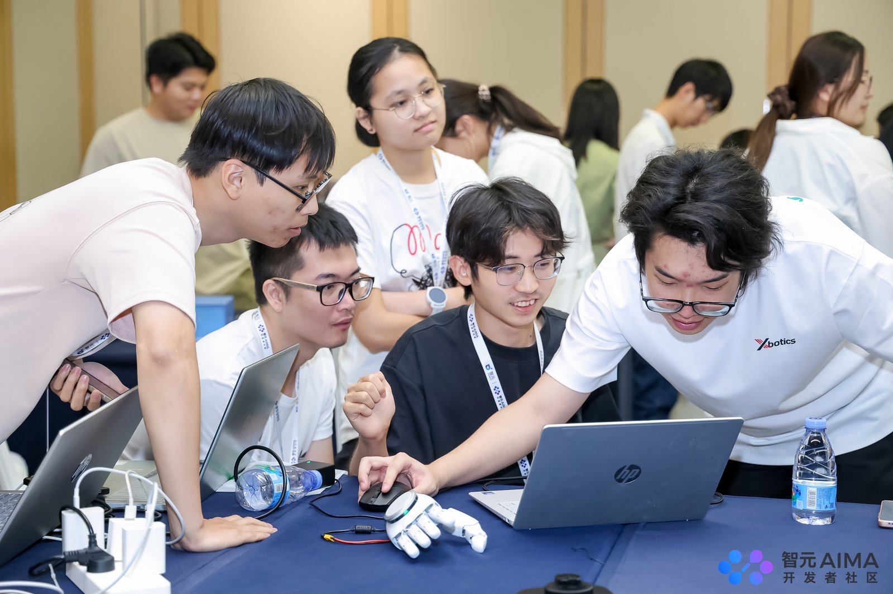

# 在智元灵巧手实训营爬了三天桌子：一个 16 自由度手的上手记录

> **读完这篇你会知道**：灵巧手的"自由度"到底指什么、为什么它比机械臂难得多；三个能当天跑通的 Demo 各自什么原理；以及我们怎么让一只平躺在桌上的手，靠 4 个键位一格一格爬到桌子对面再爬回来。
>
> 面向零基础。不需要机械臂背景，不需要会 ROS。全程 Windows + 一个摄像头 + 一只 **OmniHand 2025 灵动款（型号 O10，16 总自由度 / 10 主动自由度）**。



---

## 0. 先说结论：这玩意儿为什么难

营里老师开场放了一句话，我记到现在：

> 莫拉维克悖论——对机器来说，下棋容易，捡积木难。

灵巧手就是这句话最扎人的地方。机械臂有 6~7 个自由度，控制它本质上是"把一个点移动到另一个点"；而一只 16 自由度的灵巧手，光是"握拳"这一个动作，就涉及十几个关节的协同、接触力的分配、以及"握住之后别滑"的判断。

更实际的问题是：**它很容易卡死。** 我第一次让手弯下去抓桌面，就再也没抬起来——电机嗡嗡响，手指纹丝不动。这个坑贯穿了整篇文章，也是第 3 节比赛方案的核心。

---

## 1. 硬件：16 自由度的"16"到底是什么

先把这个词拆开讲清楚，因为后面所有讨论都建立在它上面。

### 自由度 ≠ 关节数 ≠ 电机数

我们用的是 OmniHand 2025 灵动款（营里也按型号叫 **O10**），官方标称：

| 指标         | 数值                   | 什么意思                      |
| ---------- | -------------------- | ------------------------- |
| 总自由度（DoF）  | 16                   | 整只手能"动"的独立关节数             |
| 主动自由度（DoA） | 10                   | 真的有电机在驱动的关节数，也是型号 O10 的由来 |
| 重量 / 尺寸    | 500g / 180×85×38.5mm | 比成年男性手掌略小略轻               |
| 最大指尖力      | 5N（典型值）              | 约等于捏起 500g 东西的力           |

**10 个电机怎么让 16 个关节动起来？** 靠"耦合"——部分关节没有自己的电机，而是被机械连杆拉着按比例跟着动。这叫**欠驱动**（under-actuated）。

这个区别很重要：**你能下指令的只有 10 个，剩下 6 个是"跟着走"的**，你控制不了它单独动。后面卡死的问题，根源就在这 6 个跟班关节上。

具体分布是这样：

- **拇指** 4 个关节，其中 3 个主动（弯曲 mcp、侧摆 abad、自旋 roll）
- **食指** 3 个关节，2 个主动（pip 弯曲、abad 侧摆）
- **中指** 3 个关节，只有 1 个主动（pip 弯曲，连侧摆都没有）
- **无名指 / 小指** 各 3 个关节，各 2 个主动

那个"跟着动"的关节叫 DIP（远端指间关节）。这是理解后面一切的关键：

> **你只能控 PIP，但 PIP 一弯，DIP 就按机械比例跟着卷。** PIP 弯 85°（满量程）时，DIP 会卷到 171°——整根手指完全卷成拳头、指腹贴掌、指尖顶进掌心。

这就是"弯太多就卡死"的物理根源。不是电机坏了，是手指自己把自己握死了。

### 各个关节的行程（后面要用）

| 关节        | 行程                                     |
| --------- | -------------------------------------- |
| 四指 PIP 弯曲 | 0 ~ 85°                                |
| 四指 DIP    | 耦合，随 PIP 卷到约 171°（不由你控制）               |
| 四指侧摆 abad | 食指 ±9° / 无名指 ±10° / 小指 ±11° / **中指没有** |
| 拇指 mcp 弯曲 | 0 ~ 48°                                |
| 拇指侧摆 abad | ±90°                                   |
| 拇指自旋 roll | ±60°                                   |

注意侧摆只有 9~11°，而且中指完全没有侧摆。这个"先天缺陷"后面讲转向时会反复提到——**别指望靠侧摆来转向，那是干不成事的**。

### 另一个关键约束：5N

指尖力只有 5N（典型值）。这个数字决定了：一旦手指卡在某个位置，电机能提供的"拉回来"的力是有上限的。弯得太深，5N 拉不动，就堵转、报错、卡死。

---

## 2. 三个 Demo：原理其实都很朴素

营里给了三组 Demo。我按"从简单到复杂"重新排一下，因为官方顺序里第二个 Demo 反而依赖第一个的基础。

### Demo 1：摄像头手部映射（遥操作）

**一句话**：摄像头认出你手的 21 个关键点，实时算出关节角发给灵巧手——你在镜头前做什么，它跟着做。

**原理拆成三步**：

1. **找手**：MediaPipe 的 HandLandmarker 模型，从摄像头画面里定位 21 个关键点（每根手指 4 个 + 手腕 1 个）。这是纯视觉，不需要戴手套、不需要传感器。
2. **算角度**：每个手指取三个点 `a-b-c`（比如食指的 MCP-PIP-DIP），用向量夹角公式算出弯曲角度：
   ```
   向量 ba 和向量 bc 的夹角 → 弯曲量 = π - 夹角
   ```
   伸直时三点共线，夹角 180°，弯曲量 0；弯到底夹角变小，弯曲量增大。
3. **归一化 + 映射**：人手的弯曲范围到不了机器人手的量程，所以要归一化。程序里取 135°（π×0.75）作为"满弯"的参考跨度，把它线性映射到 0~1，再乘以该关节的上限。

最小可跑版本的核心就这几行：

```python
import math
import cv2, mediapipe as mp
from omnihand import OmniHand2025, HandType

# 连手（串口名以设备管理器里的「USB 串行设备 (COMx)」为准）
hand = OmniHand2025.create_hand_by_usb(
    HandType.RIGHT, hand_device_id=1, uart_port="COM5")
hand.set_request_interval(10)
hand.set_frame_recv_timeout(500)
hand.init()

# 三点夹角 → 弯曲弧度
def flexion(a, b, c, maximum):
    ba = (a.x-b.x, a.y-b.y, a.z-b.z)
    bc = (c.x-b.x, c.y-b.y, c.z-b.z)
    dot = sum(x*y for x, y in zip(ba, bc))
    na = math.sqrt(sum(x*x for x in ba))
    nb = math.sqrt(sum(x*x for x in bc))
    bend = max(0.0, math.pi - math.acos(max(-1.0, min(1.0, dot/(na*nb)))))
    # 135° 归一化跨度 → 0~1，再乘关节上限
    return min(1.0, bend / (math.pi*0.75)) * maximum

cap = cv2.VideoCapture(0, cv2.CAP_DSHOW)
t = 0
while True:
    ok, frame = cap.read()
    if not ok:
        break
    t += 1
    rgb = cv2.cvtColor(frame, cv2.COLOR_BGR2RGB)
    res = landmarker.detect_for_video(
        mp.Image(image_format=mp.ImageFormat.SRGB, data=rgb), t*33)

    if res.hand_world_landmarks:
        lm = res.hand_world_landmarks[0]
        hand.set_all_active_joint_angles([
            0.0, 0.0, flexion(lm[1], lm[2], lm[3], 0.84),      # 拇指
            0.0, flexion(lm[5], lm[6], lm[7], 1.48),           # 食指
            flexion(lm[9], lm[10], lm[11], 1.48), 0.0,         # 中指
            flexion(lm[13], lm[14], lm[15], 1.48), 0.0,        # 无名指
            flexion(lm[17], lm[18], lm[19], 1.48)])            # 小指
    time.sleep(0.03)
```

**这里有两个值得说的细节**：

- `1.48 rad`（≈85°）是四指的 PIP 上限，`0.84 rad`（≈48°）是拇指 mcp 上限——都取自说明书量程，不是随手写的。
- **程序里比这段多一步"标定"**：让你张开手采 30 帧、闭合手再采 30 帧，然后在两个端点之间做线性映射。为什么？因为每个人的手大小、摄像头距离都不一样，用固定的 135° 兜底值会偏。标定之后，"我张开=它张开、我握拳=它握拳"才准。

### Demo 2：石头剪刀布

**一句话**：摄像头认出你出的是石头/剪刀/布，灵巧手当场出招——随机版各凭运气，"作弊版"它出克制你的那个。

**原理相比 Demo 1 是"减法"**：不需要连续映射，只需要**分类**。判定只看四指的弯曲程度是否超过阈值（0.75 rad）：

```python
index_bent  = angles[4] > 0.75
middle_bent = angles[5] > 0.75
ring_bent   = angles[7] > 0.75
pinky_bent  = angles[9] > 0.75

if all((index_bent, middle_bent, ring_bent, pinky_bent)):
    return "石头"      # 四指全弯
if not any((index_bent, middle_bent, ring_bent, pinky_bent)):
    return "布"        # 四指全伸
if not index_bent and not middle_bent and ring_bent and pinky_bent:
    return "剪刀"      # 食中伸、无名小弯
return None            # 其它姿势不判定（防误触发）
```

最后那个 `return None` 是我觉得设计上很聪明的一笔：**别的姿势不猜**，避免你手还没摆好它就抢答。工程上这叫"拒绝推理"，比强行分类靠谱得多。

作弊版就是查表：石头→布、布→剪刀、剪刀→石头。

**体验上的小细节**：准备模式下食指会来回勾引（挑逗动作），3-2-1 倒计时后才开打，5 秒内出拳，结果用大字打屏幕上（赢绿/输红/平橙）。这些都是纯 UI 层的设计，但让 Demo 现场效果好了非常多。

### Demo 3：双手 Demo（现场演示）

这组要求两只手，所以只有示范组能跑，学员不实操。但原理值得记一下，因为它第一次把**触觉**用起来了。

三个演出：

1. **双手遥操**：左手驱动左 O10、右手驱动右 O10，交叉也不串台。原理就是把 MediaPipe 检出的左右手分别路由到两个设备。
2. **双手触觉比 OK**：捏住右手任意手指 → 左手比 OK；松开 → 左手张开。这是**阈值触发**：读右手触觉值，超过阈值就切手势。
3. **含羞手**（我觉得最有意思的）：按摸右手的力度，左手对应手指按比例弯下去——摸多重弯多深；按住掌心则左手握拳。这是**连续映射**，把压力值（克）线性映射到弯曲角。

现场看点有两个：状态行会实时显示"食指 45g（100%）"这样的数字，你要盯着看它是**跟着力度连续变化**的，而不是"全或无"——后者说明映射做错了。

> 边界：USB 连接下触觉读的是降采样数据，原始数据要走 CAN-FD。触摸低于基线 +2g 不动作（防空手漂移乱抖），超过设定值封顶。

---

## 3. 比赛：让一只平躺的手爬过桌子

### 规则

长桌上贴两条胶带。灵巧手从一端爬到另一端、再爬回起点。手不能离桌（不是论文里那种撑起来走路的形态），也不追求大幅度转向。

听起来简单。实际难点在于：**这是一只平躺着的手，没有腿、没有轮子、没有腕关节，只有 10 个电机和 4 根能弯的手指。**

先看一段实际跑起来的样子：

https://github.com/rio888414/omnihand-workshop-notes/blob/main/assets/crawling-demo.mp4

<video src="assets/crawling-demo.mp4" controls width="100%" poster="assets/workshop-scene.jpg" preload="none"></video>

> 上面两种都放上了：GitHub 会渲染链接那个播放器；`<video>` 标签是给本地 Markdown 预览用的。
> 都播不了的话，直接下载：[assets/crawling-demo.mp4](assets/crawling-demo.mp4)

### 我的方案：4 个键

营里给的动作序列工具，格式是"预设名 保持时间 过渡时间"一行一步。我一开始把它拆成了 15 步子动作（左转食指、左转拇指、复位、零位……），结果发现：**按一次要按 15 下，根本来不及，而且中间任何一步错了就卡死。**

后来我把它压成 4 个键：

| 键   | 功能   | 内部动作              |
| --- | ---- | ----------------- |
| `a` | 前进一拍 | 钩 → 拇指顶 → 伸展 → 落掌 |
| `b` | 左转一拍 | 左钩 → 拇指顶 → 伸展     |
| `c` | 右转一拍 | 右钩 → 拇指顶 → 伸展     |
| `d` | 脱困   | 拇指顶 → 全伸          |

序列文本：

```
a:  前进钩 350 250     # 慢弯：静摩擦需要时间建立，钩稳
    拇指顶 200 120     # 顶起，卸载四指
    零位   250 120     # 快伸：无载+离地，借惯性过死点
    零位   100 100     # 落掌

b:  左钩 300 200
    拇指顶 200 120
    零位   250 120

c:  右钩 300 200
    拇指顶 200 120
    零位   250 120

d:  拇指顶 400 200
    零位   300 120
```
https://github.com/rio888414/omnihand-workshop-notes/issues/1
### 为什么是这几个角度（这是重点）

方案能跑起来，靠的是每个角度的取舍。我把理由一条条写出来，因为这部分最容易被当成"抄来的数字"。

**① 前进钩：四指 PIP 弯 45°，为什么不弯更多？**

45° 只有量程（85°）的一半多点。三个理由：

- **避开"卷曲锁死区"**。前面说过 DIP 是耦合的，PIP 弯 85° 时 DIP 卷到 171°，整指握拳贴掌、指尖顶进掌心。45° 时 DIP 大约卷到 90°，指尖只是"钩"住桌面，还没"卷"起来。
- **5N 的力够拉回来**。弯得越深，回伸需要克服的摩擦和连杆阻力越大。一旦超过 5N 能拉出来的范围，就堵转卡死。
- **行程够用**。45° 的钩地行程实测每拍约 2cm，60cm 的桌子爬 30 拍。要是为了行程翻倍去弯 85°，卡死一次罚的时间远超多爬两拍。

**② 拇指顶：为什么这是整个方案的心脏**

我原本以为"卡死"是电机力量不够。后来发现不是——**是手自己压死自己**。

三件事叠在一起：

1. 手指卷曲 → 指腹贴掌，指尖顶进掌心（卷曲锁死）
2. 整只手 500g 重量压在四指上 → 静摩擦锁死
3. 连杆接近量程时进入"死点"附近 → 反向力矩被放大，越难越难

结果就是：5N 拉不动。

**拇指顶地这一下，把三个问题一次解决**：手掌被抬起来 → 四指法向载荷几乎归零 → 摩擦锁死解除 → 连杆离开死点区 → 这时候 5N 轻轻一拉就伸开了。顺便，拇指还变成了一个新的锚点。

参数上：

- **abad 80°**：拇指侧摆量程 ±90°，不开到这么大，指尖根本够不着地。
- **roll 45°**：自旋让指腹朝向前下方，顶地时是"面接触"而不是"指尖点接触"，稳。
- **mcp 35°**（量程 48°）：全直（0°）顶地容易打滑，顶满 48° 又进死点还没余量。35° 是"微弯压地"——稳，且留了微调空间。

所以我没有做"卡了再按复位键"，而是**把拇指顶固化成每一拍的必经一步**。这是整个方案最大的转折。

**③ 零位：为什么每拍都要回零**

全掌 + 指腹均匀触地 = 最大支撑面 = 最稳的落点。而且所有步态都回到同一个起点，姿态误差不会累积。

**④ 转向：为什么是 35°，比直行还低？**

转向时只有半边手指承重，单指载荷翻倍，摩擦锁死阈值更低——所以再打个八折。

做法是**差速**：左转就让食指+中指钩地（右侧滑），掌绕左侧转，像坦克转向。锚哪边就往哪边转。

侧摆虽然开了满程（食指 -9°），但实际作用很小——量程就 9~11°，中指还压根没有侧摆。**真正干活的是"单侧弯曲"本身，侧摆只是锦上添花。**

### 时间参数为什么这么设

- **弯曲过渡慢（200~250ms）**：钩地靠静摩擦，弯太快钩不稳、打滑。
- **伸展过渡快（120ms）**：伸展靠动摩擦 + 惯性。快甩能把指尖甩过死点区，就算有残余卡阻也能靠冲量冲过去。
- 所有时间取 50ms 的倍数（GUI 步长限制）。

### 掉头：三个办法，按优先级

1. **桌角 pivot（推荐）**：爬到端线后把掌部一侧抵住桌角，连按转向键。桌角当支点，比在空地原地转快一倍。
2. **差速旋转（保底）**：空地直接"自主执行 b×10~20"。转角小但稳定。
3. **倒车（如果规则允许）**：先问主持人"回程是否必须头朝前"。如果不要求，换个方向爬回去，完全避开掉头——耗时最短。

### 现场标定流程（5 分钟）

1. 按一次 `a`，手机拍俯视，量位移 → 算出每拍多少 cm → 倒推自主执行轮数（60cm ÷ 2cm ≈ 30 拍）
2. 弯曲上限从 45° 开始往下试。**出现一次卡死就全局 -10%**（45° → 40°）。宁可少弯一点多爬两拍。
3. 空测转向：数按多少次能转 180°
4. 上场 checklist：24V 线理到桌子远端固定好、确认"跟随"是关的、起始位在桌沿内

---

## 4. 踩坑清单（最有价值的几条）

爬的时候会遇到各种奇怪的失败，基本都是这几个原因。我按"现象 → 先动哪个参数"整理成表，现场对着查就行：

| 现象        | 先动哪个参数                               |
| --------- | ------------------------------------ |
| 原地不动、指尖打滑 | PIP +5°，弯曲过渡 +50ms（钩更稳）              |
| 伸展卡死      | 查拇指顶拍在不在 → 伸展过渡压到 ≤120ms → 全局弯曲 -10% |
| 直行跑偏      | 强侧 -5% / 弱侧 +5%（别指望侧摆纠偏）             |
| 转向时卡死     | 转向 PIP 降到 30°，确认内嵌拇指顶                |
| 越爬越斜      | 每 5 拍插一拍反向微调                         |

---

## 5. 一点感想

最反直觉的一件事：**让手变强的方法，不是让它弯得更深，而是让它更懂得在什么时候松开。**

我一开始所有精力都花在"怎么钩得更牢"上——加大弯曲角度、加长保持时间。结果全是卡死。真正的突破是承认"这只手在特定姿态下会自己锁死"，然后设计一套步态去**绕开那个区域**，而不是硬闯。

这大概也是灵巧操作这整个领域的缩影：真正难的不是算出一个抓取姿势，而是在接触、摩擦、死点这些不完美的物理约束里，找到一条能重复走通的路。

---

## 参考

- OmniHand SDK：<https://github.com/AgibotTech/agillink_omnihand_sdk>
- OmniHand 文档：<https://www.agibot.com.cn/DOCS/OS/Omnihand-O10>
- MediaPipe Hand Landmarker：<https://ai.google.dev/edge/mediapipe/solutions/vision/hand_landmarker>
- 莫拉维克悖论：Moravec, H. (1988). *Mind Children*

---

*本文基于一次实训营的实际操作记录。文中的角度、时间参数是在具体硬件上的实测起点，不是通用最优解——换手型或换桌面材质都需要重新调。*

---

## 许可

正文采用 [CC BY 4.0](https://creativecommons.org/licenses/by/4.0/)；文中代码片段可自由使用（MIT）。
